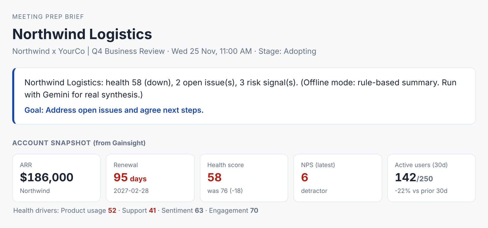
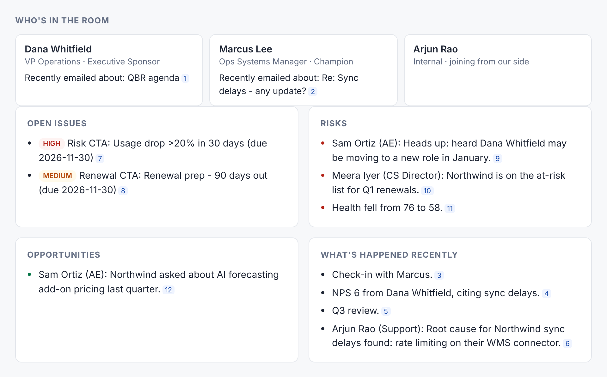
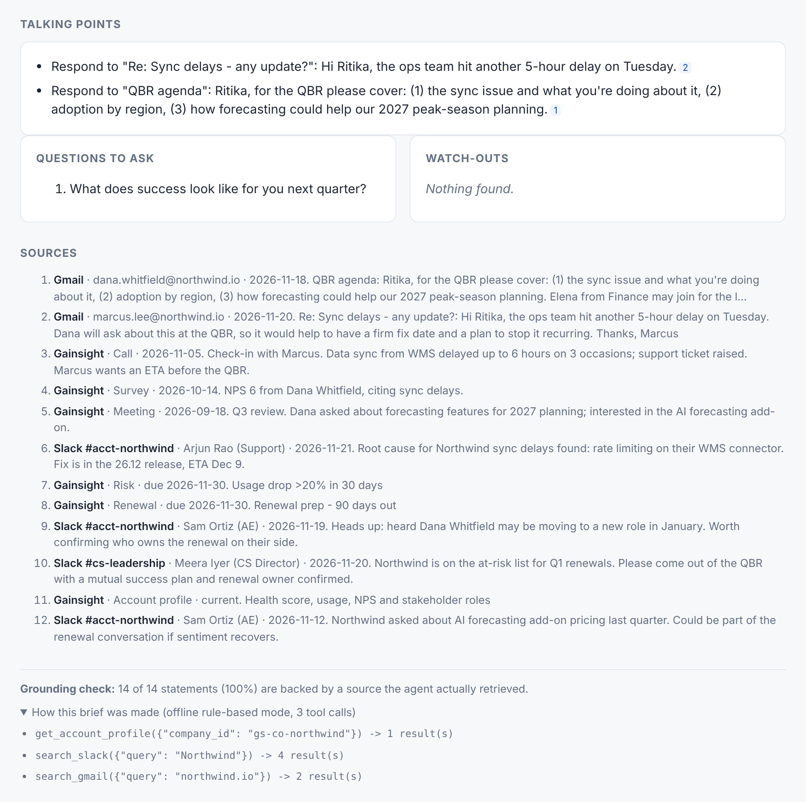

# CSM Meeting Prep Agent

CSMs spend 20–30 minutes before every customer call digging through Gainsight, Slack and email.
This agent does it for them. It checks the CSM's calendar, works out which upcoming meetings are
customer calls, researches each account, and writes a one-page HTML prep brief.

**[See a sample brief →](https://jindal.github.io/AI-work/csm-meeting-prep-agent/sample_brief.html)** (generated from the synthetic data in offline mode)

## What the CSM gets

**At a glance:** the situation in two lines, the meeting goal, and the account's key numbers straight from Gainsight.



**Who's in the room and what's going on:** stakeholders and their roles, open issues, risks, opportunities and recent activity. Every point links to its source.



**What to say, and why you can trust it:** talking points and questions, the numbered sources behind every claim, a grounding score, and a trace of each tool call the agent made.



## How it works

```
Calendar ──► 1. FIND customer meetings  (external attendee domain → Gainsight account)
                    │
                    ▼
             2. RESEARCH  Gemini agent decides what to look up, using 3 tools:
                    │       get_account_profile (Gainsight) · search_slack · search_gmail
                    ▼
             3. WRITE     brief as JSON; every claim must cite the record ids it came from
                    │
                    ▼
             4. VERIFY    grounding check: cited ids must be records the tools actually returned
                    │
                    ▼
             5. RENDER    HTML brief (numbers come straight from Gainsight, never from the LLM)
```

**Design choices**
- **It's an agent, not a fixed script.** The model chooses its own searches, e.g. searching Slack
  for a stakeholder's name after spotting them in an email, and stops when it has enough.
- **Facts vs judgement.** ARR, health score, renewal date and usage are rendered directly from
  Gainsight. The LLM only does what needs judgement: risks, talking points, questions to ask.
- **Grounding check.** Each statement in the brief cites its sources. Claims citing nothing, or citing
  an id that was never retrieved (a hallucination), are flagged *unverified* in the brief.
  The footer shows the score and a trace of every tool call.

## Run it

```bash
pip install -r requirements.txt

# Demo data, no API key needed (rule-based stand-in for the LLM)
python agent.py --llm offline

# Demo data with the real Gemini agent (free key: https://aistudio.google.com/apikey)
export GEMINI_API_KEY=...
python agent.py
```

Briefs are written to `briefs/`. The demo data (`sample_data.json`) has three meetings tomorrow:
a QBR with an at-risk account, a check-in with an account ready to expand, and an internal standup
that the agent correctly skips.

## Connect real data (`--source live`)

| Source | What you need |
|---|---|
| Google Calendar + Gmail | OAuth desktop client from Google Cloud, saved as `credentials.json` (read-only scopes) |
| Slack | `SLACK_USER_TOKEN`: a user token (`xoxp-`) with `search:read` |
| Gainsight | `GAINSIGHT_DOMAIN`, `GAINSIGHT_ACCESS_KEY`, and `GAINSIGHT_DOMAIN_FIELD` (the Company field holding the email domain) |

The live Gainsight connector reads Company fields only. CTAs, timeline and stakeholders need the
Cockpit, Timeline and Person APIs, whose field names vary by org (TODOs in `connectors.py`).

## Files

| File | What it does |
|---|---|
| `agent.py` | The whole pipeline: find meetings, agent loop, grounding check, render |
| `connectors.py` | Mock connectors (sample data) and live API connectors, with identical methods |
| `brief_template.html` | Layout of the brief |
| `sample_data.json` | Synthetic calendar, Gainsight, Slack and Gmail data |
| `sample_brief.html` | Example output for the at-risk account's QBR |

## Ideas for next steps
- Run it every morning on a schedule and post the briefs to Slack
- Add past call transcripts (Gong/Zoom) as a fourth source
