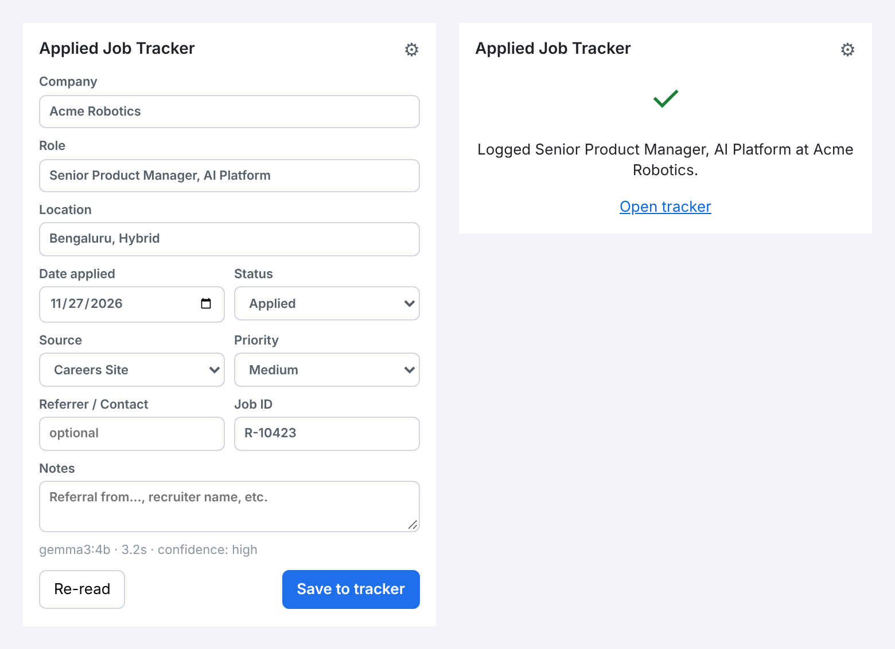
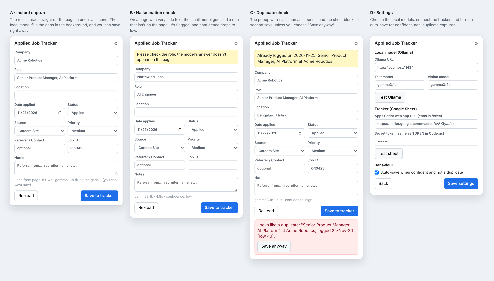

# Applied Job Tracker (Chrome extension)

**Log a job application in one click, even when the company never sends a confirmation email.**

Open any page that says you've applied, click the extension and then **Note**. A model running on your own laptop reads the page and pulls out the company, role, location and job ID. You check the fields and save, and the job lands as a row in your Google Sheet tracker.



<sub>The screenshot uses sample data.</sub>

### Key screens


## The problem
When you apply to dozens of roles, an email-based tracker misses every company that doesn't send a confirmation. Those applications fall through the cracks: no follow-up, no record, sometimes you apply twice. This extension captures the application at the moment it happens, on the page itself.

## What it does
- **One click:** when the page shows the role, the form fills in about a second. The model fills in the rest in the background, and you can save without waiting.
- **Works on any job site:** LinkedIn, Naukri, Workday, Greenhouse, Lever, company career sites, and the "thank you for applying" pages that come after you submit.
- **Several tabs at once:** click Note in one tab and move on. Each tab keeps working in the background, and the icon shows **…** while it's reading and **✓** when it's ready to save.
- **No duplicates:** it warns you if the job is already in your tracker, matching on the job link or on company + role. That includes jobs added from Gmail.
- **Private by default:** the model runs locally through Ollama. Nothing leaves your laptop except the row saved to your own sheet.
- **You stay in control:** every capture goes through a review step, where you can fix anything and add a referrer, priority or notes before saving.

## How it works

```
Job page
  │
  ├─► 1. Page rules: job title from the site header, "received your application for …",
  │      "Requisition ID", schema.org JobPosting data           (instant, exact)
  │
  ├─► 2. Text model (Ollama, JSON-schema output)                (fills the gaps)
  │
  ├─► 3. Vision model on a screenshot, only if 1–2 aren't enough (slowest, rarely needed)
  │
  ├─► 4. Grounding check: is the role actually on the page?   (flags hallucinations)
  │
  ▼
Review popup  ──►  Google Apps Script  ──►  Google Sheet (first empty row, duplicate check)
```

### Decision logic in detail

**1. Capture.** Each capture runs in the background worker and is tracked per tab.

| Step | What happens |
|---|---|
| Click **Note** | A screenshot is taken straight away, while the tab is still visible, and the page is read. |
| Read the page | The reader collects: schema.org `JobPosting` data; the open job's header, using per-site selectors for LinkedIn, Naukri, Workday, Lever and Greenhouse; confirmation phrases ("received your application for …"); a requisition or job ID; "applied" phrases; and the main job panel's text (3,000 characters if structured data exists, otherwise 6,000). Side lists and "similar jobs" are skipped. |
| Instant result | If the page gives the role, the form shows it within about a second. The company comes from the header, then the structured data, then a guess from the URL (`careers.acme.com` → Acme). |
| Text model | Runs when there's any usable text. It returns a fixed JSON format at temperature 0, capped at 200 tokens. The model stays loaded for 30 minutes and starts loading when the popup opens. |
| Trust order | Page header and structured data first, then the model. Values read from the page always override the model's. Confidence is set to high when both the title and the company come from the header. |
| Grounding check | If the model's role isn't found anywhere in the page text, confidence is set to low and the popup shows "Please check the role". |
| Vision fallback | Runs only if company or role is still missing, or confidence is low. The screenshot is resized to 1,280 px wide and sent to the vision model. Its answers fill gaps without overwriting good text-based values. |
| Auto-save | Only if it's turned on in Settings, confidence is high, company and role are both present, and the job isn't already logged. |

**2. Review.** What you type is saved as a draft for that tab, so it survives the popup closing, and the model never overwrites it. The extension icon shows **…** while it's working, **✓** when it's ready to save and **!** on an error.

**3. Save (Apps Script).**
- **Duplicates:** the job counts as a duplicate if the link matches (ignoring tracking parameters and trailing slashes) or if company + role match (ignoring case and punctuation). The popup also warns as soon as it opens if this browser has logged the job before. **Save anyway** overrides the check.
- **Where the row goes:** the first empty row, based on the Company column. Formula columns are never written. If the row has no formulas or dropdowns yet, they're copied from the row above. A lock stops two saves from colliding.
- **Values:** Source, Status and Priority are matched to the sheet's dropdown values. Anything unknown falls back to *Careers Site*, *Applied* and *Medium*. Last Update is set to today and Next Step to "Wait for recruiter".

**4. URLs.** Tracking parameters are stripped and job-ID parameters are kept. LinkedIn search and collection links are turned into `/jobs/view/<id>`, so the same job always gets the same link.

**5. Settings.** A link pasted into the wrong box (for example, the Google link in the Ollama box) is repaired automatically when you save.

## AI concepts in this project

| Concept | How it's used |
|---|---|
| **Local, open-weight models** | Gemma runs on the laptop through Ollama: no API cost, and private. The model size is a speed-versus-accuracy setting. |
| **Structured output** | The model has to answer in a fixed JSON format, so its output always maps onto the form fields. |
| **Prompt design for extraction** | Explicit rules (the hiring company, not the job board), temperature 0, and today's date so the model can convert "Applied 3 days ago". |
| **Multimodal fallback** | When the page text isn't enough, a screenshot goes to a vision model. |
| **Model cascade** | Simple page rules run first, then a small text model, then a vision model only when needed. This keeps capture fast and cheap. |
| **Grounding and hallucination check** | If the model returns a role that doesn't appear on the page, the popup warns you. This came from a real bug: on a sparse confirmation page, the model guessed "AI Engineer" for a "Product Manager" role. |
| **Human in the loop** | You review every capture before it's saved. Auto-save is optional and only happens when confidence is high. |
| **Context and latency management** | Only the main job panel is sent to the model, trimmed in length. The model loads when the popup opens, stays in memory between captures, and answers are capped at a short length. |

## Product decisions
- **Local model over a cloud API.** Job searches are personal data, and the task is simple extraction, so a small local model is good enough and costs nothing. The trade-off is setup effort and speed on older laptops.
- **Rules before the model.** Most pages already state the title clearly. Reading it directly is instant and can't hallucinate, so the model is only used for what's left.
- **Review by default.** A wrong row in a tracker is worse than an extra click. Auto-save is available once you trust it.
- **Write into the existing tracker.** The extension fills the tracker's own columns and dropdowns, and its summary and daily-log tabs keep working unchanged.

## Setup (about 15 minutes, one time)

### 1. Install Ollama and download a model
1. Install Ollama from https://ollama.com/download.
2. Download a model in a terminal:
   ```bash
   ollama pull gemma3:4b      # ~3 GB, reads text and images, fine on 8 GB RAM
   ollama pull gemma3:1b      # optional: much faster text model
   ```

### 2. Let the extension talk to Ollama
Ollama blocks browser extensions by default. Allow them like this:

- **macOS:** run `launchctl setenv OLLAMA_ORIGINS "chrome-extension://*"`, then quit Ollama from the menu bar and open it again. This resets when you reboot.
- **Windows:** add a user environment variable named `OLLAMA_ORIGINS` with the value `chrome-extension://*`. Then quit Ollama from the system tray and open it again.
- **Linux:** run `sudo systemctl edit ollama.service`, add `Environment="OLLAMA_ORIGINS=chrome-extension://*"` under `[Service]`, then run `sudo systemctl restart ollama`.
- **Quickest test on any system:** quit the Ollama app, then run `OLLAMA_ORIGINS="chrome-extension://*" ollama serve` and leave that terminal open.

### 3. Connect the tracker sheet
`Code.gs` writes into a tab called **Applications** with these columns:

`#` · Company · Role · Location · Job Link · Source · Referrer / Contact · Date Applied · Resume Version · Status · Last Update · Next Step · Next Step Date · Days Since Applied · Days Since Update · Priority · Notes

It fills the first empty row and leaves the formula columns (#, Days Since Applied, Days Since Update) alone. Source, Status and Priority use the sheet's own dropdown values. To use a different layout, change the column positions in `Code.gs`.

1. Open the tracker spreadsheet and go to **Extensions → Apps Script**. Paste in `Code.gs`.
2. Change `TOKEN` at the top to any random string and save.
3. Click **Deploy → New deployment → Web app**, with Execute as **Me** and access **Anyone**. The token is what keeps other people out.
4. Approve the permissions and copy the **Web app URL** (it ends in `/exec`).

> If you edit `Code.gs` later, go to **Deploy → Manage deployments → Edit** and deploy a **New version**.

### 4. Load the extension
1. Go to `chrome://extensions`, turn on **Developer mode**, click **Load unpacked** and select this folder. Pin the extension.
2. Click the extension icon, then **⚙︎** to open Settings. Paste the web app URL and the token.
3. Click **Test Ollama** and **Test sheet**. Both should show ✓. Click **Save settings**.

## Daily use
1. Open a job you've applied to, or the "thank you" page after you apply.
2. Click the extension, then **Note this application**.
3. Check the fields and click **Save to tracker**.

## Settings
| Setting | Default | Notes |
|---|---|---|
| Ollama URL | `http://localhost:11434` | |
| Text model | `gemma3:4b` | `gemma3:1b` is about 3–4× faster |
| Vision model | `gemma3:4b` | Must accept images (gemma3, qwen2.5vl, llama3.2-vision …) |
| Auto-save | off | Saves without review when confidence is high and the job isn't a duplicate |

## Troubleshooting
| Message | Fix |
|---|---|
| "Ollama blocked the extension" | Repeat step 2, and make sure you fully quit and reopen Ollama |
| "Can't reach Ollama" | Open the Ollama app, or run `ollama serve` |
| "Model not found" | `ollama pull <model>` |
| "Please check the role" | The model's answer isn't on the page. Correct it before saving |
| The first capture is slow | The model is loading into memory. Later captures are faster |
| "Sheet replied with a web page" | Redeploy the Apps Script with access set to **Anyone** |
| "Wrong token" | The token in Settings must match `TOKEN` in `Code.gs` |

## Files
| File | What it is |
|---|---|
| `manifest.json` | Chrome extension config |
| `core.js` | All the logic: page reader, local model calls, Google Sheet client, and the background worker that runs captures per tab |
| `popup.html` / `popup.js` | The popup: capture, review, save and settings. Chrome requires the script to be a separate file |
| `Code.gs` | Google Apps Script to paste into the tracker sheet |
| `icon.png`, `screenshot.png`, `screens.png` | Icon and README images |

## Success criteria
- An application is logged in 2 clicks or fewer, in under 10 seconds once the model is loaded
- Company and role are correct on at least 18 of 20 real pages
- Duplicates are caught 100% of the time
- Nothing leaves the laptop except the row written to the sheet

## Roadmap
- **Evals:** 20 saved job pages with known answers, scored for accuracy and speed across `gemma3:1b`, `gemma3:4b` and the page rules alone
- Detect the "Applied" banner automatically and offer to log the job without a click
- Status updates and follow-up reminders from the popup
