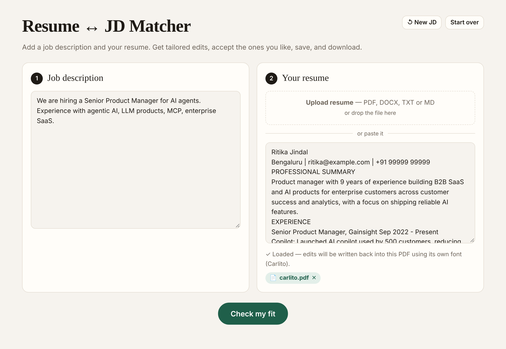
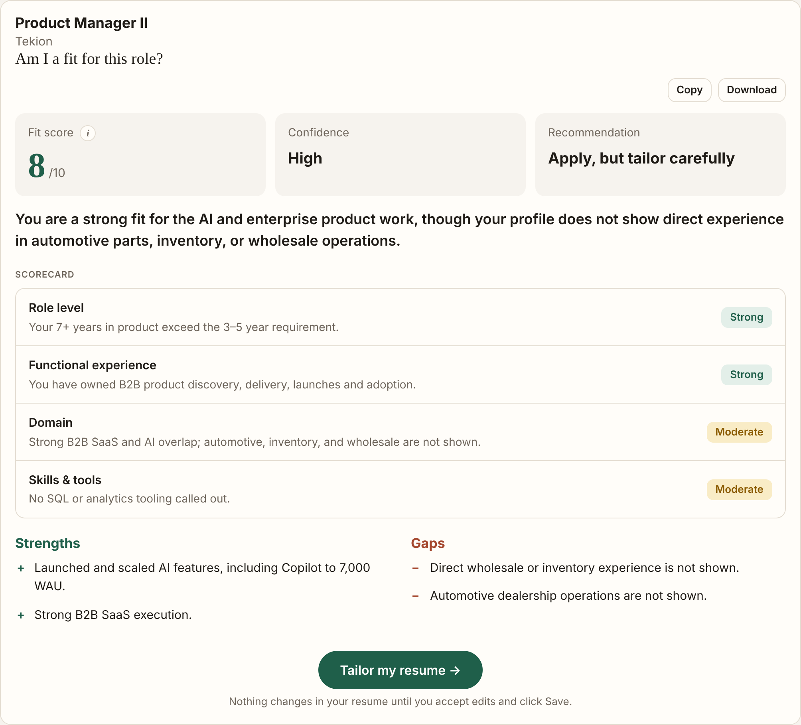
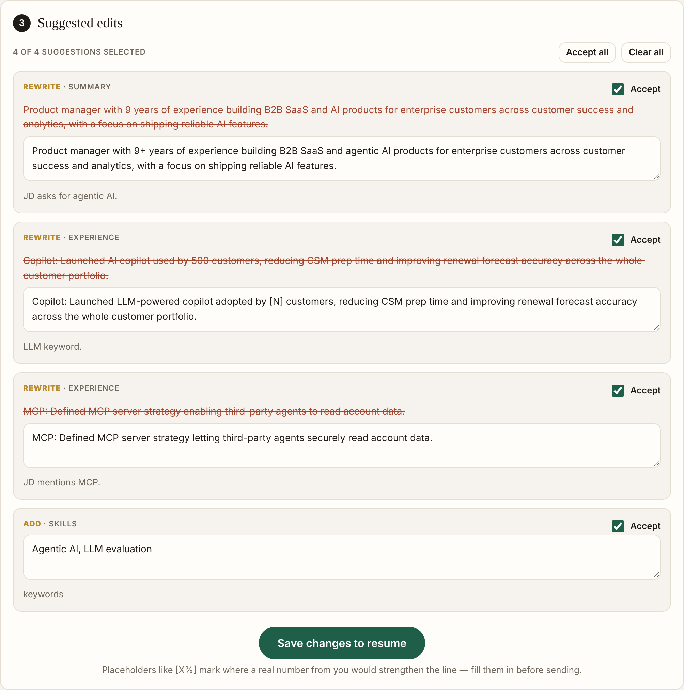
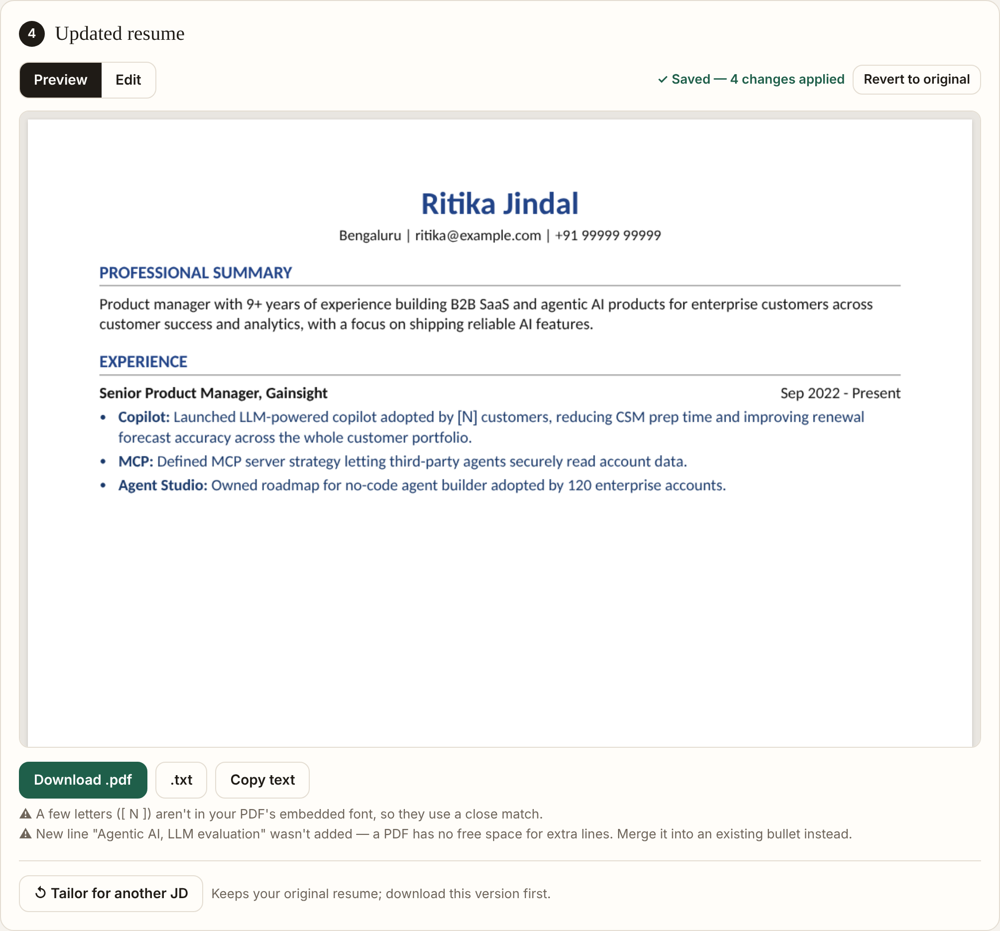

[**▶ Open the app**](https://jindal.github.io/AI-work/resume-jd-matcher/) · [Full version with AI (claude.ai)](https://claude.ai/artifact/8Gr4SX5xo29CjogtRbFN5k)

# Resume ↔ JD Matcher

A small web app that checks how well your resume fits a job description, then helps you tailor the resume for that role without losing its original formatting.

**Live page:** https://jindal.github.io/AI-work/resume-jd-matcher/

> The AI steps (fit check and tailoring) only run inside claude.ai, where the app was built. On this GitHub Pages copy, uploading, previewing, editing and downloading work, but "Check my fit" will report that AI matching isn't available.

## Screenshots

**1. Add a job description and your resume**

**2. Fit report: score, confidence, recommendation, scorecard, strengths and gaps**

**3. Suggested edits you can accept, change or skip**

**4. Updated resume in the original PDF's format, ready to download**

_Screenshots use a sample resume and a sample job description._

## What it does

1. **Paste a job description** and **upload your resume** (PDF, Word, TXT or Markdown) or paste it as text.
2. **Check my fit** gives a fit report:
   - Fit score out of 10, confidence, and an apply recommendation
   - A scorecard (role level, functional experience, domain, skills) rated Strong / Moderate / Weak
   - Strengths and gaps against the role
3. **Tailor my resume** suggests targeted edits. Accept, change or skip each one.
4. **Save** applies the accepted edits, then **download** the updated resume.
5. **New JD** starts again for another role while keeping your resume loaded.

## Keeps your original format

- **Word (.docx):** edits are patched into the original file, keeping fonts, styles and layout.
- **PDF:** edited lines are rewritten in place using the PDF's own embedded font, size, colour and margins, and the replaced text is removed from the text layer so ATS parsers don't see the old wording.

Known limits: PDFs that store text as drawings (Type 3 fonts) fall back to a similar font, letters missing from a PDF's embedded font use a stand-in, and PDFs can't take brand-new lines, only edits to existing ones.

## Safety

Job description and resume text are treated as untrusted data. Instruction-like text in a JD is flagged and ignored, the AI's output is sanitised, and suggestions containing unexpected links or contact details are dropped. Nothing is applied until you click Save.

## Tech

A single self-contained `index.html` with no build step. It uses pdf.js, pdf-lib, JSZip, docx and mammoth (loaded from CDNs), plus inlined fonts and a custom PDF text-replacement engine.
